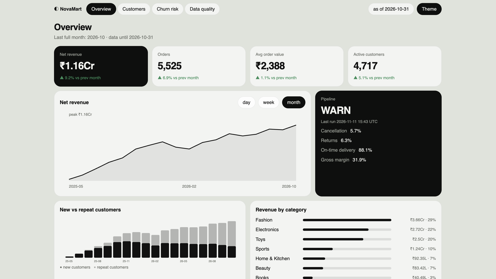
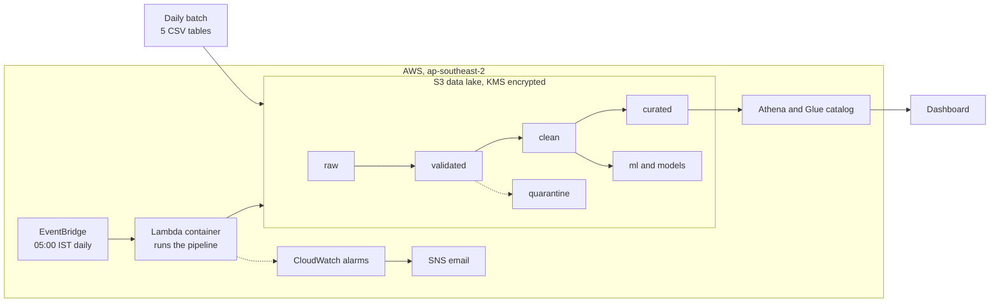
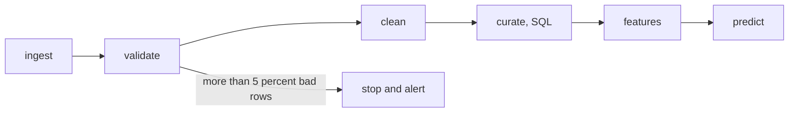

# NovaMart Decision Platform

An end-to-end data platform for a fictional Indian online retailer: messy daily CSV files go in, and trusted KPIs, a churn model and a dashboard come out. It runs locally and on AWS (S3, Lambda, Athena, Terraform), with data validation, tests and alerts built in.

All data is synthetic. No real personal data is used anywhere.

 


## What it does

- **Generates** 5 tables (customers, products, orders, order items, payments) with realistic defects injected on purpose: duplicates, bad emails, wrong date formats, future-dated orders, unknown customers, mismatched payment amounts.
- **Ingests** each daily batch into an immutable raw zone, with checksums so a repeated file is skipped.
- **Validates** every row. Bad rows go to a quarantine zone with a reason; the pipeline stops and alerts when more than 5% of a table fails.
- **Cleans** types and formats, then builds **curated** tables with SQL (DuckDB): revenue KPIs by day, week and month, customer 360, retention, RFM segments, top products and categories.
- **Predicts churn** (no order in the next 90 days) with a time-based split, honest evaluation against simple baselines, and a batch score for every active customer.
- **Runs on AWS** once a day: an encrypted S3 data lake, a Lambda container, Athena for SQL, CloudWatch alarms and email alerts, all defined in Terraform.
- **Shows** the results in a single-file dashboard.

## Architecture



One run of the pipeline:



### Data lake zones

| Zone | Holds | Rule |
|---|---|---|
| `raw/` | Files exactly as received | Never edited |
| `validated/` | Rows that passed validation | Same columns as raw |
| `quarantine/` | Rows that failed, with `reject_reason` | Never deleted |
| `clean/` | Typed Parquet | Fixes types only, never drops rows |
| `curated/` | KPI and customer tables | No names or emails |
| `ml/`, `models/` | Churn features, the trained model | |
| `reports/` | One validation report per run | |

## Results

On the synthetic data (50,000 customers, about 62,000 orders):

- Net revenue in the last full month (Oct 2026): ₹1.16 crore, 5,525 orders, average order value ₹2,388.
- Validation quarantines 0.1% to 1.5% of rows per table and warns on missing emails and inconsistent payment methods.
- **Churn model:** PR-AUC 0.785 on a held-out test month, against 0.783 for the simple rule "no order for 60 days" and 0.716 for "everyone churns". The model is only slightly better than the rule. Most customers in this data order rarely (46% ordered once), so a 90-day silence is normal even for active customers. The full report is in [`docs/model_report.md`](docs/model_report.md).

## Repository layout

```
src/dp/        the pipeline: ingest, validate, clean, curate, features, train, predict, dashboard
               cloud.py, pipeline.py, handler.py (the AWS job), catalog.py (Athena tables)
sql/           KPI models, one SELECT per file
infra/         Terraform: S3 + KMS, Athena, IAM, ECR, Lambda, schedule, alarms, budget
dashboard/     template and the generated single-file page
docs/          business brief, KPI definitions, model report
tests/         78 tests
Dockerfile     the Lambda container image
```

## Run it locally

```bash
python3 -m venv .venv && source .venv/bin/activate
pip install -e . pytest

python3 -m dp.generate_data --customers 50000
python3 -m dp.ingest
python3 -m dp.validate --as-of 2026-10-31
python3 -m dp.clean
python3 -m dp.curate
python3 -m dp.features
python3 -m dp.train
python3 -m dp.predict
python3 -m dp.dashboard && open dashboard/index.html

pytest
```

## Deploy to AWS

Needs the AWS CLI, Terraform and Docker. Credentials come from `aws login`, no access keys are stored.

```bash
aws login --profile <profile>
eval "$(aws configure export-credentials --profile <profile> --format env)"

cd infra && terraform init && terraform apply     # bucket, key, roles, ECR repository, Lambda, alarms
cd ..
docker build --platform linux/arm64 --provenance=false -t <ecr-url>:v1 .
docker push <ecr-url>:v1                          # then set image_tag and apply again
```

`infra/terraform.tfvars` holds `alert_email` and is not committed.

## Design decisions

- **Raw is immutable, bad rows are quarantined, not deleted.** Nothing is lost, and every rejected row says why.
- **Warn or quarantine.** A missing email only warns, because the customer still exists. Duplicate keys, bad prices, unknown references and wrong payment amounts are quarantined.
- **No hidden "today".** Every step takes an as-of date, so a run can be repeated exactly.
- **Time-based split for the model,** with a 90-day gap between train, validation and test, so no training label depends on orders from the test period.
- **Least privilege.** The pipeline role can read `source/`, `raw/` and `models/`, write only the zones it produces, and delete nothing. The S3 bucket is private, versioned, encrypted with a customer-managed key and refuses non-TLS requests.
- **Cost guard.** Athena queries stop at 1 GiB scanned, ECR keeps three images, and a budget alert fires at 80% of 10 USD.
- **Failures leave evidence.** When validation stops the run, the report and the quarantined rows are still saved before the error is raised.

## Known gaps

- A customer whose row was quarantined (for example a wrong signup date format) is missing from `customer_360`, but their orders still count in revenue.
- An order whose payment row was quarantined counts as unpaid until the source is fixed.
- The synthetic data is static, so the daily run reports "no new data" after the first day. That counts as a successful run and does not raise an alarm.
- The dashboard is a snapshot rebuilt by `python3 -m dp.dashboard`, not a live app.

See [`docs/kpi_definitions.md`](docs/kpi_definitions.md) for how every KPI is calculated and [`docs/business_brief.md`](docs/business_brief.md) for goals, KPIs and service levels.

Operations (alerts, redeploys, shutting down): see [`docs/runbook.md`](docs/runbook.md).
